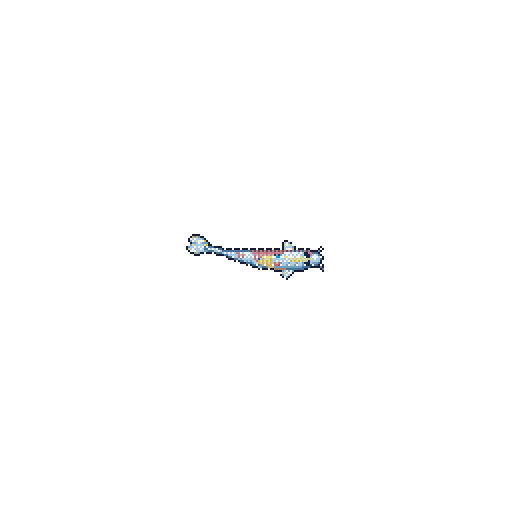

 

 

---

## 👨‍💻 About Me

Hey! I'm **Nurti** — a developer who enjoys experimenting with code, building useful applications and exploring technology.

- 🐍 Python is my main programming language.
- 🔵 Currently learning C.
- 🐧 Interested in Linux, Hyprland and customization.
- ⚙️ Enjoy building desktop applications and useful tools.
- 🚀 Always learning and trying new things.

> "Build. Break. Learn. Repeat."

## 🛠️ Tech Stack

**Currently working with:**

| Technology | Focus |
|:---|:---|
| Python | Application development |
| C | Learning fundamentals |
| Linux | Daily environment |
| Git & GitHub | Version control |

---

## 🚀 Featured Projects

---

## 📊 GitHub Statistics

 

---

## 🔹 Currently Learning C

My learning roadmap:

- [ ] C syntax, variables and data types
- [ ] Conditions and loops
- [ ] Functions
- [ ] Arrays and strings
- [ ] Pointers and memory management
- [ ] Structures
- [ ] Build my first C project

> One step at a time. No rush.

---

## 🐟 My Koi

 

<i>A little koi swimming through my coding journey.</i>

---

### Thanks for visiting! 💙

**Build. Learn. Repeat.**

